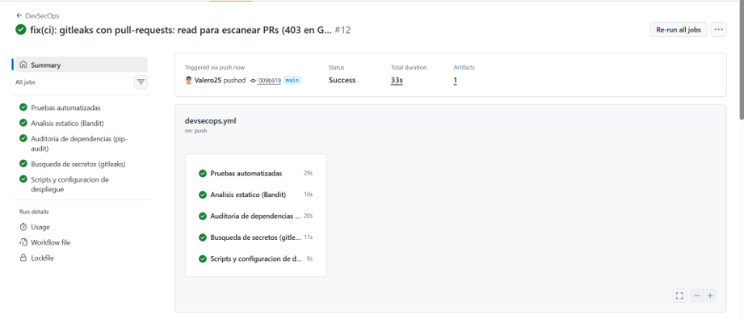
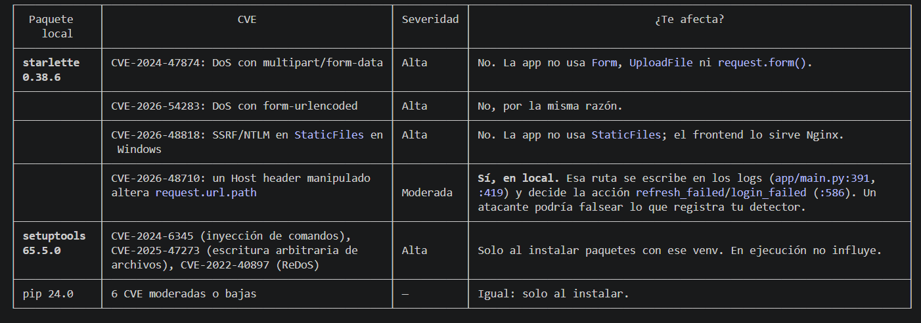

# Informe — Lab 05: Seguridad en el ciclo de desarrollo (DevSecOps con GitHub Actions)

**Fundamentos de Seguridad de la Información · Escuela Colombiana de Ingeniería Julio Garavito**
**Equipo:** Ana Gabriela Fiquitiva Poveda · Juan David Valero Abril
**Proyecto evaluado:** MuvAutomation (API FastAPI + Nginx + WAF), el mismo del Lab 3
**Repositorio:** <https://github.com/Valero25/FDSI_LAB_Aplicacion-web-publica-por-HTTP-construir-atacar-detectar-corregir-y-verificar>

> *"Un repositorio no está protegido por tener código. Está mejor protegido cuando sus controles se ejecutan y generan evidencia."*
> Este informe muestra, para cada control, **qué se configuró, qué encontró, qué se corrigió y cómo se volvió a comprobar**.

---

## Índice

1. [Resumen ejecutivo](#1-resumen-ejecutivo)
2. [Alcance, autorización y línea base](#2-alcance-autorización-y-línea-base)
3. [Arquitectura del pipeline](#3-arquitectura-del-pipeline)
4. [SAST: Semgrep, CodeQL y Bandit](#4-sast-semgrep-codeql-y-bandit)
5. [Detección de secretos: gitleaks y secret scanning](#5-detección-de-secretos-gitleaks-y-secret-scanning)
6. [SCA: Dependabot, Dependency Review y pip-audit](#6-sca-dependabot-dependency-review-y-pip-audit)
7. [DAST: OWASP ZAP baseline](#7-dast-owasp-zap-baseline)
8. [Pentest controlado: Host header y audit log (H-3)](#8-pentest-controlado-host-header-y-audit-log-h-3)
9. [Matriz de hallazgos y priorización](#9-matriz-de-hallazgos-y-priorización)
10. [Remediación con Pull Requests](#10-remediación-con-pull-requests)
11. [Prueba de que el pipeline bloquea (PRs de demostración)](#11-prueba-de-que-el-pipeline-bloquea-prs-de-demostración)
12. [Limitaciones y riesgo residual](#12-limitaciones-y-riesgo-residual)
13. [Conclusiones y aprendizajes](#13-conclusiones-y-aprendizajes)
14. [Anexo: entregables y cómo reproducir](#14-anexo-entregables-y-cómo-reproducir)

---

## 1. Resumen ejecutivo

| Indicador | Resultado |
|---|---|
| Controles integrados | **SAST** (Semgrep, CodeQL, Bandit) · **Secretos** (gitleaks, secret scanning, push protection) · **SCA** (Dependabot, Dependency Review, pip-audit) · **DAST** (ZAP baseline) · **Pentest** manual · **Ruleset** de merge |
| Hallazgos analizados | **14**: 8 reales (H-1 a H-8) y 6 falsas alarmas o riesgos aceptados (F-1 a F-6) |
| Hallazgos corregidos | **8 de 8**, cada uno con PR y evidencia del antes y el después |
| Pruebas de regresión nuevas | **8** (suite de 263 → **271** pruebas) |
| Pull Requests de remediación | [#5](https://github.com/Valero25/FDSI_LAB_Aplicacion-web-publica-por-HTTP-construir-atacar-detectar-corregir-y-verificar/pull/5), [#6](https://github.com/Valero25/FDSI_LAB_Aplicacion-web-publica-por-HTTP-construir-atacar-detectar-corregir-y-verificar/pull/6), [#12](https://github.com/Valero25/FDSI_LAB_Aplicacion-web-publica-por-HTTP-construir-atacar-detectar-corregir-y-verificar/pull/12), [#13](https://github.com/Valero25/FDSI_LAB_Aplicacion-web-publica-por-HTTP-construir-atacar-detectar-corregir-y-verificar/pull/13), [#14](https://github.com/Valero25/FDSI_LAB_Aplicacion-web-publica-por-HTTP-construir-atacar-detectar-corregir-y-verificar/pull/14), [#17](https://github.com/Valero25/FDSI_LAB_Aplicacion-web-publica-por-HTTP-construir-atacar-detectar-corregir-y-verificar/pull/17) |
| Estado final en GitHub | 0 alertas abiertas de CodeQL, Dependabot y secret scanning · ruleset `proteger-main` activo |
| Hallazgo más grave | **H-3**: un `Host` manipulado falseaba el audit log (integridad). Lo encontró la combinación de SCA y validación manual; ninguna herramienta sola lo detectó |

---

## 2. Alcance, autorización y línea base

### 2.1 Sistema evaluado

| Campo | Valor |
|---|---|
| Tecnología | Python 3.12, FastAPI, Starlette, Uvicorn, SQLite, PyJWT (Ed25519), Argon2id, TOTP. Frontend HTML/CSS/JS sin dependencias. Nginx 1.26 (TLS 1.3/1.2), ModSecurity v3 + OWASP CRS, fail2ban |
| Commit de línea base | [`44ddc48`](https://github.com/Valero25/FDSI_LAB_Aplicacion-web-publica-por-HTTP-construir-atacar-detectar-corregir-y-verificar/commit/44ddc48e5ebc02fc46f6fe96e52bb8f7a11dca9a) |
| Rama del laboratorio | [`security/lab-fsi`](https://github.com/Valero25/FDSI_LAB_Aplicacion-web-publica-por-HTTP-construir-atacar-detectar-corregir-y-verificar/tree/security/lab-fsi) |
| APIs | `POST/GET /alerts`, `GET /alerts/{id}`, `POST /alerts/{id}/actions`, `POST /auth/login`, `/auth/refresh`, `/auth/logout`, `GET /network/devices[/{id}]` |
| Autenticación | Login con contraseña, TOTP y JWT EdDSA (tokens solo en memoria, **sin cookies**) · `X-Analyst-Key` · `X-API-Key` para el emisor de alertas |
| Riesgo principal | **Integridad de la trazabilidad**: si se falsea el audit log, se oculta un ataque a la detección (`scripts/detect.py`) y a fail2ban |

### 2.2 Autorización y reglas de enfrentamiento

Todo el sistema (código, repositorio y VM) es **propio del equipo**. Solo se usaron datos ficticios.

| Permitido | Prohibido |
|---|---|
| Análisis estático del repositorio | Producción, IP o dominios de terceros |
| ZAP **baseline pasivo** contra el staging aislado (`localhost` o el runner de GitHub) | Escaneo activo, fuerza bruta, denegación de servicio |
| Peticiones **inocuas** en un contenedor aislado (pentest H-3) | Exfiltración o uso de datos personales reales |
| Cuentas y claves ficticias, generadas al arrancar | Publicar credenciales en evidencias (gitleaks con `--redact`) |

El detalle completo está en [docs/SECURITY.md §1](docs/SECURITY.md).

### 2.3 Decisión de riesgo: el repositorio pasó a público

CodeQL, secret scanning y Dependency Review **no están disponibles en repositorios privados** de cuentas personales sin GitHub Advanced Security. Por eso, el 2026-11-10, el equipo publicó el repositorio. Esto revierte una parte del gap **G12** del Lab 3, y se aceptó de forma consciente:

- **Verificación previa:** gitleaks sobre todo el historial (`no leaks found`), ninguna rama con contenido sensible, sin `.env`, `.pem` ni bases de datos.
- **Riesgo:** P = 1 (la VM está en una NAT privada) × I = 2 (conocer las reglas del WAF) = **2, bajo**.
- **Compensación:** push protection, gitleaks en cada PR, el ruleset y una deploy key de solo lectura. Por el principio de Kerckhoffs, la seguridad depende de las claves, que nunca estuvieron en Git.

Ver [docs/SECURITY.md §5](docs/SECURITY.md#5-decisión-de-riesgo-repositorio-público-revisión-de-g12).

---

## 3. Arquitectura del pipeline

```
          push / pull_request a main
                    │
   ┌────────────────┼──────────────────────────────┬─────────────────────────┐
   ▼                ▼                              ▼                         ▼
DevSecOps        Seguridad estática             CodeQL                  Dependabot
(devsecops.yml)  (seguridad-estatica.yml)       (default setup)         (dependabot.yml)
├ pytest         ├ Semgrep → resultado-semgrep  ├ Python                ├ alerts + security updates
├ Bandit         ├ gitleaks                     ├ JS / TS               └ version updates: Actions
├ pip-audit      └ Dependency Review (solo PR)  └ Actions                  y pip (cooldown de 7 días)
├ gitleaks
└ ShellCheck
                    │
                    ▼
   Ruleset "proteger-main": PR obligatorio + 7 checks en verde + CodeQL sin high/error
                    │                    sin force push · sin borrado · sin bypass
                    ▼
                  merge
                    │
   workflow_dispatch ▼
DAST staging (dast-staging.yml): staging HTTPS en el runner → ZAP baseline
                                 → puerta .zap/rules.tsv → artefacto informe-zap
```

**Principios aplicados** (diapositiva 25, "buenas prácticas"):

- **Permisos mínimos:** `permissions: contents: read` global. Solo el job de gitleaks agrega `pull-requests: read`.
- **Versiones fijadas:** todas las acciones van por SHA de commit y las imágenes por *digest*.
- **Cadena de suministro:** `cooldown` de 7 días en Dependabot.

Fragmento real de [.github/workflows/seguridad-estatica.yml](.github/workflows/seguridad-estatica.yml):

```yaml
permissions:
  contents: read

jobs:
  semgrep:
    name: SAST (Semgrep)
    runs-on: ubuntu-24.04
    container:
      # semgrep/semgrep 1.181.1
      image: semgrep/semgrep@sha256:3db5c7af55eb1f512eac0abf0ab69a97b52c74b5e9a27314c221aee1a78d7ab2
    steps:
      - uses: actions/checkout@3d3c42e5aac5ba805825da76410c181273ba90b1 # v7.0.1
        with:
          persist-credentials: false
      - name: Analisis completo            # informe para el artefacto, no corta el job
        run: |
          semgrep scan --config p/default --config p/python --config p/secrets --metrics=off \
            --exclude docs --exclude evidencias \
            --json --output semgrep.json --sarif-output semgrep.sarif || true
      - name: Puerta de severidad alta     # un ERROR nuevo falla el pipeline
        run: |
          semgrep scan --config p/default --config p/python --config p/secrets --metrics=off \
            --exclude docs --exclude evidencias --severity ERROR --error

  revision-dependencias:
    if: github.event_name == 'pull_request'
    name: SCA (Dependency Review)
    steps:
      - uses: actions/dependency-review-action@a1d282b36b6f3519aa1f3fc636f609c47dddb294 # v5.0.0
        with:
          fail-on-severity: moderate
```

**Ruleset `proteger-main`** (configuración exportada en [docs/evidencias/ci/ruleset-proteger-main.json](docs/evidencias/ci/ruleset-proteger-main.json)):

| Regla | Efecto |
|---|---|
| `pull_request` | No hay push directo a `main` |
| `required_status_checks` (7) | SAST (Semgrep) · Secretos (gitleaks) · SCA (Dependency Review) · Pruebas automatizadas · Bandit · pip-audit · CodeQL |
| `code_scanning` | CodeQL sin alertas *security high or higher* ni *errors* |
| `non_fast_forward`, `deletion` | Sin reescribir ni borrar `main` |
| Bypass list vacía | Ni siquiera el administrador se salta las reglas |

---

## 4. SAST: Semgrep, CodeQL y Bandit

### 4.1 Resultados

| Herramienta | Antes | Después | Evidencia |
|---|---|---|---|
| Semgrep (`p/default`, `p/python`, `p/secrets`) | 7 hallazgos: 3 ERROR, 1 MEDIUM, 3 WARNING | **0** (`Ran 546 rules on 63 files: 0 findings`) | [antes](docs/evidencias/antes/semgrep-antes.json) → [después](docs/evidencias/despues/semgrep-despues.json) · [artefacto de la CI](docs/evidencias/ci/resultado-semgrep/semgrep.json) |
| CodeQL (suite `extended`, 176 reglas) | 3 alertas en Python | 1 *fixed*, 1 falsa alarma, 1 riesgo aceptado | [alertas](docs/evidencias/ci/codeql/codeql-alertas-antes.json) · [run 42888933539](https://github.com/Valero25/FDSI_LAB_Aplicacion-web-publica-por-HTTP-construir-atacar-detectar-corregir-y-verificar/actions/runs/42888933539) |
| Bandit | 0 altas, 0 medias | 0 altas, 0 medias | [bandit-antes.txt](docs/evidencias/antes/bandit-antes.txt) |

### 4.2 Dos resultados de Semgrep explicados (verdadero y falso positivo)

**Verdadero positivo: `dependabot-missing-cooldown` (MEDIUM) → H-5.** Dependabot proponía versiones el mismo día de su publicación; si una acción se compromete, la versión maliciosa llegaría como PR de inmediato. Corrección:

```yaml
# .github/dependabot.yml
  - package-ecosystem: github-actions
    directory: /
    schedule:
      interval: weekly
    cooldown:
      default-days: 7      # una semana para que la comunidad detecte y retire una versión maliciosa
```

**Falso positivo: `formatted-sql-query` (ERROR) → F-1.** Semgrep ve un f-string dentro de `conn.execute`, pero los identificadores salen de una **constante del código**, no del cliente. Además, SQLite no admite parámetros `?` para nombres de columna en `ALTER TABLE`. Se dejó la supresión con su justificación en el propio código:

```python
for column, sql_type in NEW_COLUMNS:   # constante definida en el código, sin datos del cliente
    conn.execute(f"ALTER TABLE alerts ADD COLUMN {column} {sql_type}")  # nosemgrep: <regla> (justificado)
```

### 4.3 CodeQL: lo que Semgrep no vio

| Alerta | Clasificación | Acción |
|---|---|---|
| #1 `py/bad-tag-filter` (high) | **Verdadero positivo → H-7** | La prueba que prohíbe scripts en línea no reconocía `</script >`; se corrigió la expresión regular. Ahora está *fixed* |
| #3 `py/log-injection` (medium) | **Falso positivo → F-5** | `json.dumps` escapa `\n` y `\r`. Se demostró con una prueba nueva y se descartó como *False positive* |
| #2 `py/clear-text-logging-sensitive-data` (high) | **Riesgo aceptado → F-6** | La CLI del administrador muestra el secreto TOTP una sola vez, para enrolarlo. Se descartó como *Won't fix* |

Corrección de H-7 ([tests/test_frontend.py](tests/test_frontend.py)):

```diff
- scripts = re.findall(r"<script\b([^>]*)>(.*?)</script>", html, re.I | re.S)
+ # El cierre admite espacios y atributos (</script >, </script foo>), que el navegador acepta.
+ scripts = re.findall(r"<script\b([^>]*)>(.*?)</script\b[^>]*>", html, re.I | re.S)
```

Prueba que demuestra el falso positivo F-5 ([tests/test_api.py](tests/test_api.py)):

```python
def test_audit_log_cannot_be_forged_with_newlines_from_the_client(client):
    forged = '{"action":"login_ok","actor":"login:admin"}'
    before = len(_audit_actions())
    client.get("/alerts/x%0A%0D" + forged.replace('"', "%22"), headers=ANA)
    new = _audit_actions()[before:]          # json.loads de cada línea: una línea forjada se vería
    assert all(e["action"] != "login_ok" for e in new)
    assert any(e.get("path", "").startswith("/alerts/x\n\r{") for e in new)  # quedó dentro del campo
```

Línea real del audit log durante la prueba: el salto de línea queda **escapado dentro de un solo registro JSON**:

```json
{"action": "validation_error", "method": "GET", "path": "/alerts/x\n\r{\"action\":\"login_ok\",\"actor\":\"login:admin\"}", "result": "validation_error"}
```

---

## 5. Detección de secretos: gitleaks y secret scanning

| Control | Antes | Después |
|---|---|---|
| gitleaks (historial completo) | **13 coincidencias** | **0** (`no leaks found`). Las 13 se revisaron una por una: claves de prueba, una variable vacía y un `curl` sin credencial. Se ignoran por **huella exacta** en [.gitleaksignore](.gitleaksignore) (F-4) |
| GitHub secret scanning + push protection | No disponible (repositorio privado) | Activo, **0 alertas** |

**H-1: gitleaks fallaba en todos los PR.** `gitleaks-action` lista los commits del PR y, con `contents: read` solamente, la API respondía `403`. Los PRs #1, #3 y #4 de Dependabot estaban en rojo **por el control, no por un secreto**: el control de secretos estaba ciego en los PR. Corrección (commit `009b919`), sin ampliar los permisos de los demás jobs:

```yaml
  secretos:
    name: Busqueda de secretos (gitleaks)
    permissions:
      contents: read        # se repite: los permisos del job reemplazan a los globales
      pull-requests: read   # gitleaks-action lista los commits del PR (403 sin este permiso)
```

Evidencia: el run [#12](https://github.com/Valero25/FDSI_LAB_Aplicacion-web-publica-por-HTTP-construir-atacar-detectar-corregir-y-verificar/actions/runs/40784768358) y el [#18](https://github.com/Valero25/FDSI_LAB_Aplicacion-web-publica-por-HTTP-construir-atacar-detectar-corregir-y-verificar/actions/runs/40785462060) quedaron en verde.



---

## 6. SCA: Dependabot, Dependency Review y pip-audit

### 6.1 Dependencia analizada: Starlette 0.38.6 (H-2)

pip-audit sobre el entorno virtual local encontró **35 vulnerabilidades** (Starlette 0.38.6, setuptools 65.5.0 y pip 24.0). En vez de actualizar a ciegas, se revisó **si cada una aplica al código**:

| CVE / familia | ¿Aplica? | Razón |
|---|---|---|
| DoS con multipart y urlencoded | ❌ | La app no usa `Form` ni `UploadFile`, y responde 415 a todo lo que no sea JSON |
| `StaticFiles` | ❌ | El frontend lo sirve Nginx |
| **Host header que altera `request.url.path`** | ✅ | **Sí aplica** → se validó en el pentest (H-3) |
| setuptools y pip | ❌ en tiempo de ejecución | Solo afectan al instalar paquetes |

**Medida correctiva:** se reinstaló el venv desde los archivos fijados (0 CVE) y se agregó [tests/test_dependencias.py](tests/test_dependencias.py), que falla si el entorno no coincide con los *pins* o si Starlette es menor que 1.3. Evidencia: [antes](docs/evidencias/antes/pip-audit-venv-local-antes.txt) → [después](docs/evidencias/despues/pip-audit-venv-local-despues.txt).



### 6.2 Decisiones sobre las propuestas de Dependabot (diapositiva 15)

| PR | Propuesta | ¿Se usa la ruta? | ¿Corrige un CVE? | ¿Rompe pruebas? | Decisión |
|---|---|---|---|---|---|
| #7, #8 | fastapi/uvicorn desde la raíz | — | — | — | **Duplicados (H-8):** `requirements-dev.txt` incluye `-r app/requirements.txt`. Se corrigió con `allow` en [dependabot.yml](.github/dependabot.yml) y se cerraron |
| #9 | pytest 9.0.3 → 9.2.0 | Solo desarrollo | No | No (CI en verde) | Fusionar |
| #10 | uvicorn 0.40 → 0.54 | Sí (servidor ASGI) | No | No (CI en verde, incluida la regresión de H-3) | Validado también con DAST ([§11.3](#113-validación-de-las-actualizaciones-de-dependabot-10-y-11)): sin cambios → **se aprueba** |
| #11 | fastapi 0.142 → 0.162 | Sí (arrastra Starlette, base de H-3) | No | No | Igual que #10: DAST sin cambios → **se aprueba** |

Corrección de H-8:

```yaml
  - package-ecosystem: pip
    directory: /
    allow:                     # la raíz solo vigila las dependencias propias de desarrollo
      - dependency-name: pytest
      - dependency-name: httpx
```

### 6.3 Otros hallazgos SCA

- **H-6:** pytest 8.4.2 tenía PYSEC-2026-1845. Se actualizó a `pytest==9.0.3` tras comprobar que toda la suite pasa, y la CI ahora audita también `requirements-dev.txt`.
- **Dependency Review** frena en cada PR cualquier dependencia nueva con una vulnerabilidad moderada o mayor. En un *push* aparece como *skipped* a propósito, porque no hay un PR contra el cual comparar.

---

## 7. DAST: OWASP ZAP baseline

### 7.1 Staging autorizado

GitHub Actions **no alcanza la VM**, que está en una NAT privada (`192.168.61.0/24`). Por eso `dast-staging.yml` levanta dentro del runner un **staging HTTPS aislado** ([deploy/staging-local](deploy/staging-local/Dockerfile)): el Nginx del repo, más la API y claves ficticias generadas al arrancar. Así ZAP analiza `https://localhost:8443/app/` y nunca sale del runner.

### 7.2 Resultados

| Momento | Resumen | Alertas medias | Evidencia |
|---|---|---|---|
| Antes (local) | 0 FAIL · 8 WARN · 60 PASS | **10055** (CSP) y 10202 (CSRF) | [zap-antes.html](docs/evidencias/antes/zap-antes.html) |
| Después, en CI ([run 40792582162](https://github.com/Valero25/FDSI_LAB_Aplicacion-web-publica-por-HTTP-construir-atacar-detectar-corregir-y-verificar/actions/runs/40792582162)) | 0 FAIL · 7 WARN · 61 PASS | Solo 10202 (falsa alarma F-3) | [informe-zap.html](docs/evidencias/ci/informe-zap/informe-zap.html) |
| Después del PR #6 ([run 42891157649](https://github.com/Valero25/FDSI_LAB_Aplicacion-web-publica-por-HTTP-construir-atacar-detectar-corregir-y-verificar/actions/runs/42891157649)) | Igual | Solo 10202 | [informe-zap-final](docs/evidencias/ci/informe-zap-final/informe-zap.html) |
| **Con la puerta de regresión** ([run 42950461992](https://github.com/Valero25/FDSI_LAB_Aplicacion-web-publica-por-HTTP-construir-atacar-detectar-corregir-y-verificar/actions/runs/42950461992)) | `FAIL-NEW: 0 · WARN-NEW: 6 · IGNORE: 1 · PASS: 61` | 10202 → IGNORE justificado | [zap-puerta-verde.md](docs/evidencias/mejoras/zap-puerta-verde.md) |

### 7.3 H-4: CSP sin `form-action` ni `base-uri` (ZAP 10055)

`form-action`, `base-uri` y `frame-ancestors` **no heredan** de `default-src`, así que la política original no restringía el envío de formularios ni la etiqueta `<base>`:

```diff
# nginx/muvautomation.conf  (y la constante API_CSP en app/main.py, como defensa en profundidad)
- add_header Content-Security-Policy "default-src 'none'; frame-ancestors 'none'" always;
+ add_header Content-Security-Policy "default-src 'none'; form-action 'none'; base-uri 'none'; frame-ancestors 'none'" always;
```

Evidencia del después ([csp-despues.txt](docs/evidencias/despues/csp-despues.txt)):

```
Content-Security-Policy: default-src 'none'; form-action 'none'; base-uri 'none'; frame-ancestors 'none'
```

Prueba de regresión ([tests/test_nginx_frontend.py](tests/test_nginx_frontend.py)):

```python
def test_every_csp_declares_directives_without_fallback():
    # Regresion ZAP 10055: form-action, base-uri y frame-ancestors NO heredan de default-src.
    https = nginx_conf.https_server(nginx_conf.site_text())
    for csp in (nginx_conf.headers(https)["Content-Security-Policy"], FRONTEND_CSP, API_CSP):
        directives = {d.split()[0] for d in csp.split(";") if d.strip()}
        assert {"form-action", "base-uri", "frame-ancestors"} <= directives, csp
```

### 7.4 Del informe a la puerta: `.zap/rules.tsv`

El kit pide usar `-I` en el primer laboratorio y *"cambiar a un control estricto cuando haya triage"*. Con el triage hecho, [.zap/rules.tsv](.zap/rules.tsv) convierte el DAST en una **puerta de regresión**:

```text
10055	FAIL	(CSP: Failure to Define Directive with No Fallback)    ← H-4 no puede volver
10038	FAIL	(Content Security Policy (CSP) Header Not Set)
10020	FAIL	(Missing Anti-clickjacking Header)
10021	FAIL	(X-Content-Type-Options Header Missing)
10035	FAIL	(Strict-Transport-Security Header Not Set)
10010	FAIL	(Cookie No HttpOnly Flag)                              ← la app no usa cookies
10011	FAIL	(Cookie Without Secure Flag)
10202	IGNORE	(Absence of Anti-CSRF Tokens)                          ← F-3, justificado: Bearer sin cookies
```

```yaml
# .github/workflows/dast-staging.yml
zap-baseline.py -t "$TARGET" -c rules.tsv -r informe-zap.html -J informe-zap.json -w informe-zap.md -I
```

Con `-I`, los WARN siguen sin romper el build, pero **un FAIL sí lo rompe**. Las alertas informativas restantes (10015, 10027, 10031, 10049, 10109 y 10111) se revisaron y se explican en [REPORTE_HALLAZGOS.md](docs/REPORTE_HALLAZGOS.md).

---

## 8. Pentest controlado: Host header y audit log (H-3)

**Hipótesis.** El audit log y la decisión entre `login_failed` y `refresh_failed` usan `request.url.path`. Starlette construye esa URL con la cabecera **`Host`**, que controla el cliente. Con Starlette < 1.3, un `Host: lab/auth/refresh?` debería cambiar la ruta registrada.

**Validación inocua.** Un login con cuerpo inválido (`{roto`) en un contenedor aislado, sin cuentas reales. El procedimiento es reproducible con [deploy/staging-local/validar-host-header.sh](deploy/staging-local/validar-host-header.sh):

```bash
docker run --rm -e OLD=1 -v "$PWD:/src:ro" -w /src python:3.12-slim bash deploy/staging-local/validar-host-header.sh
```

**Antes** ([validar-host-header-antes.txt](docs/evidencias/antes/validar-host-header-antes.txt)). Ambas peticiones fueron a `POST /auth/login`, pero la segunda se registró como otra cosa:

```json
{"action": "login_failed",   "method": "POST", "path": "/auth/login",   "result": "unauthorized"}
{"action": "refresh_failed", "method": "POST", "path": "/auth/refresh", "result": "unauthorized"}
```

**Impacto (integridad).** Un atacante podía hacer pasar sus intentos de login por intentos de *refresh*, con lo que engañaba a `detect.py` y a las reglas que cuentan los fallos de login.

**Corrección** (commit [`5bac705`](https://github.com/Valero25/FDSI_LAB_Aplicacion-web-publica-por-HTTP-construir-atacar-detectar-corregir-y-verificar/commit/5bac70575585b82a51eba75d44367008c993729f)): se usa la ruta que de verdad se enrutó, que no depende del `Host`:

```diff
+def route_path(request: Request) -> str:
+    """Ruta que de verdad se enruto (la del request line), acotada para el log."""
+    return request.scope["path"][:256]
 ...
-        path=request.url.path[:256],
+        path=route_path(request),
 ...
-        action = "refresh_failed" if request.url.path == "/auth/refresh" else "login_failed"
+        action = "refresh_failed" if request.scope["path"] == "/auth/refresh" else "login_failed"
```

**Después** ([validar-host-header-despues.txt](docs/evidencias/despues/validar-host-header-despues.txt)), **incluso con Starlette 0.38.6 vulnerable**:

```json
{"action": "login_failed", "method": "POST", "path": "/auth/login", "result": "unauthorized"}
{"action": "login_failed", "method": "POST", "path": "/auth/login", "result": "unauthorized"}
```

A través de Nginx, el mismo `Host` recibe **400** y no llega a la app ([host-header-nginx.txt](docs/evidencias/despues/host-header-nginx.txt)).

**Prueba de regresión.** Se comprobó que **falla con el código anterior** ([regresion-host-codigo-antes.txt](docs/evidencias/antes/regresion-host-codigo-antes.txt)):

```python
@pytest.mark.parametrize("host", ["lab/auth/refresh?", "lab/alerts#", "lab:8000/x/../auth/refresh?"])
def test_spoofed_host_cannot_rewrite_audited_path_or_action(client, host):
    r = client.post("/auth/login", content=b"{roto", headers={"Content-Type": "application/json", "Host": host})
    assert r.status_code == 401
    entry = base._audit_actions()[-1]
    assert entry["action"] == "login_failed" and entry["path"] == "/auth/login"
```

```
E       AssertionError: assert ('refresh_failed' == 'login_failed'
```

---

## 9. Matriz de hallazgos y priorización

Riesgo = **probabilidad × impacto**, en escala 1–3 (1–2 bajo, 3–4 medio, 6–9 alto). La severidad de la herramienta **no** decide sola: cuenta el contexto.

| ID | Herramienta | Hallazgo | CIA | P×I | Riesgo | Decisión | Evidencia |
|---|---|---|---|---|---|---|---|
| **H-1** | CI / gitleaks | gitleaks fallaba en los PR (403) | I | 3×2 | **Alto** | ✅ Corregido (`009b919`) | runs #12 y #18 |
| **H-3** | Pentest + SCA | `Host` manipulado falsea el audit log | **I** | 2×3 | **Alto** | ✅ Corregido (`5bac705`) | [antes](docs/evidencias/antes/validar-host-header-antes.txt) → [después](docs/evidencias/despues/validar-host-header-despues.txt) |
| **H-2** | pip-audit | Starlette 0.38.6 con 35 CVE en el venv | C/I/D | 1×3 | Medio | ✅ Corregido | [antes](docs/evidencias/antes/pip-audit-venv-local-antes.txt) → [después](docs/evidencias/despues/pip-audit-venv-local-despues.txt) |
| **H-5** | Semgrep | Dependabot sin `cooldown` | I | 1×3 | Medio | ✅ Corregido | [semgrep-antes.json](docs/evidencias/antes/semgrep-antes.json) |
| **H-8** | Revisión manual | PRs duplicados de Dependabot | I | 3×1 | Medio | ✅ Corregido (PR #12) | PRs #7 y #8 |
| **H-4** | ZAP 10055 | CSP sin `form-action` ni `base-uri` | I | 1×2 | Bajo | ✅ Corregido + puerta DAST | [zap-antes.json](docs/evidencias/antes/zap-antes.json) → [csp-despues.txt](docs/evidencias/despues/csp-despues.txt) |
| **H-7** | CodeQL #1 | La prueba no detectaba `</script >` | I | 1×2 | Bajo | ✅ Corregido (PR #6) | alerta #1 *fixed* |
| **H-6** | pip-audit | pytest 8.4.2 con un CVE | I | 1×1 | Bajo | ✅ Corregido | — |
| F-1 | Semgrep | SQL formateado en `ALTER TABLE` | — | — | — | ⚪ Falsa alarma (constante) | `nosemgrep` justificado |
| F-2 | Semgrep | Dockerfile sin `USER` | — | — | — | ⚪ Falsa alarma (procesos sin privilegios) | — |
| F-3 | ZAP 10202 | Formulario sin token anti-CSRF | — | — | — | ⚪ Falsa alarma (Bearer, sin cookies) | IGNORE en rules.tsv |
| F-4 | gitleaks | 13 coincidencias en el historial | — | — | — | ⚪ Falsas alarmas (claves de prueba) | `.gitleaksignore` |
| F-5 | CodeQL #3 | Log injection | — | — | — | ⚪ Falsa alarma (con prueba) | test nuevo |
| F-6 | CodeQL #2 | El secreto TOTP se imprime | C | 1×3 | Medio | 🟡 Riesgo aceptado | *Won't fix* |

**Orden de corrección:** primero H-1 (el control de secretos estaba ciego) y H-3 (el activo más crítico), aunque H-2 tenía CVE *high*: con el contexto, su alcance real era menor. El detalle está en [docs/REPORTE_HALLAZGOS.md §2.1](docs/REPORTE_HALLAZGOS.md).

---

## 10. Remediación con Pull Requests

| PR | Contenido | Checks |
|---|---|---|
| [#5](https://github.com/Valero25/FDSI_LAB_Aplicacion-web-publica-por-HTTP-construir-atacar-detectar-corregir-y-verificar/pull/5) | H-1 a H-6, los workflows Semgrep, gitleaks y ZAP, y la documentación del antes y el después | ✅ DevSecOps (5 jobs) y Seguridad estática |
| [#6](https://github.com/Valero25/FDSI_LAB_Aplicacion-web-publica-por-HTTP-construir-atacar-detectar-corregir-y-verificar/pull/6) | CodeQL (H-7, F-5, F-6), Dependency Review, Dependabot pip y el checklist de PR | ✅ 12 checks |
| [#12](https://github.com/Valero25/FDSI_LAB_Aplicacion-web-publica-por-HTTP-construir-atacar-detectar-corregir-y-verificar/pull/12) | H-8 (Dependabot duplicado) y la evidencia ZAP final | ✅ 12 checks |
| [#13](https://github.com/Valero25/FDSI_LAB_Aplicacion-web-publica-por-HTTP-construir-atacar-detectar-corregir-y-verificar/pull/13) | Documentación del ruleset `proteger-main`. Fue el primer PR que pasó por la puerta | ✅ 12 checks |
| [#14](https://github.com/Valero25/FDSI_LAB_Aplicacion-web-publica-por-HTTP-construir-atacar-detectar-corregir-y-verificar/pull/14) | Autorización, decisión G12, priorización P×I y enlaces | ✅ 12 checks |
| [#17](https://github.com/Valero25/FDSI_LAB_Aplicacion-web-publica-por-HTTP-construir-atacar-detectar-corregir-y-verificar/pull/17) | ZAP como puerta de regresión (`.zap/rules.tsv`) | ✅ |

Cada PR lleva el checklist del kit ([docs/CHECKLIST_PR.md](docs/CHECKLIST_PR.md)), que también es la plantilla de PR del repositorio.

---

## 11. Prueba de que el pipeline bloquea (PRs de demostración)

La pregunta final de la clase fue: *¿qué demuestra seguridad?* No basta con mostrar checks en verde: hay que demostrar que **se ponen en rojo cuando deben**. Se abrieron dos PRs borrador que **introducen vulnerabilidades a propósito**. Ninguno se fusiona. Estado y checks capturados en [docs/evidencias/mejoras/prs-demo-bloqueados.txt](docs/evidencias/mejoras/prs-demo-bloqueados.txt).

### 11.1 Regresión de H-4: CSP rota ([PR #16](https://github.com/Valero25/FDSI_LAB_Aplicacion-web-publica-por-HTTP-construir-atacar-detectar-corregir-y-verificar/pull/16))

```diff
- add_header Content-Security-Policy "default-src 'none'; form-action 'none'; base-uri 'none'; frame-ancestors 'none'" always;
+ add_header Content-Security-Policy "default-src 'none'; frame-ancestors 'none'" always;
```

| Capa | Resultado |
|---|---|
| **DAST** ([run 42950614751](https://github.com/Valero25/FDSI_LAB_Aplicacion-web-publica-por-HTTP-construir-atacar-detectar-corregir-y-verificar/actions/runs/42950614751)) | ❌ `FAIL-NEW: 1` → `CSP: Failure to Define Directive with No Fallback [10055] x 2`, con la anotación `ZAP encontro una regla en FAIL (regresion de seguridad)` ([informe](docs/evidencias/mejoras/zap-puerta-regresion-csp.md)) |
| **pytest** ([run 42950911218](https://github.com/Valero25/FDSI_LAB_Aplicacion-web-publica-por-HTTP-construir-atacar-detectar-corregir-y-verificar/actions/runs/42950911218)) | ❌ `test_every_csp_declares_directives_without_fallback` → `AssertionError: default-src 'none'; frame-ancestors 'none'` (y `test_frontend_csp_only_in_its_location`) |
| **Ruleset** | 🔒 PR en estado **BLOCKED**: el check obligatorio *Pruebas automatizadas* falló. El DAST manual la atrapa además en tiempo de ejecución: **dos capas independientes** |

### 11.2 Inyección SQL nueva ([PR #15](https://github.com/Valero25/FDSI_LAB_Aplicacion-web-publica-por-HTTP-construir-atacar-detectar-corregir-y-verificar/pull/15))

```python
# DEMO (NO FUSIONAR): el parámetro "ip" llega del cliente y se concatena en la consulta (CWE-89).
@app.get("/demo/alerts-by-ip")
def demo_alerts_by_ip(ip: str, analyst: Analyst = Depends(require_analyst)):
    with get_db() as conn:
        rows = conn.execute("SELECT id FROM alerts WHERE source_ip = '" + ip + "'").fetchall()
    return [row["id"] for row in rows]
```

| Capa | Resultado |
|---|---|
| **CodeQL** | ❌ Alerta nueva **#4 `py/sql-injection` (high)** en `app/main.py:1091`, que viola la regla *code scanning* del ruleset |
| **Semgrep** ([run 42950880952](https://github.com/Valero25/FDSI_LAB_Aplicacion-web-publica-por-HTTP-construir-atacar-detectar-corregir-y-verificar/actions/runs/42950880952)) | ❌ `sqlalchemy-execute-raw-query` **❰❰ Blocking ❱❱** → `Ran 188 rules on 65 files: 1 finding` |
| **pytest** ([run 42950880980](https://github.com/Valero25/FDSI_LAB_Aplicacion-web-publica-por-HTTP-construir-atacar-detectar-corregir-y-verificar/actions/runs/42950880980)) | ❌ `test_auth_scope_is_derived_from_the_route_dependencies`: toda ruta nueva debe declararse en el inventario de autorización. Es una invariante de arquitectura que también la detecta |
| **Bandit** | ✅ No la bloquea: B608 es severidad *medium* y la puerta solo corta en *high*. Por eso conviene tener varias herramientas |
| **Ruleset** | 🔒 PR **BLOCKED**: 3 checks obligatorios en rojo (CodeQL, Semgrep y pytest) |

**Lectura:** tres herramientas distintas, con técnicas distintas (flujo de datos, patrones e invariantes de pruebas), detectan la misma vulnerabilidad. Ninguna persona del equipo podía fusionarla, ni siquiera el administrador, porque la lista de bypass está vacía.

### 11.3 Validación de las actualizaciones de Dependabot (#10 y #11)

Antes de decidir sobre las actualizaciones de producción, se ejecutó el DAST sobre cada rama de Dependabot, además de la CI que ya estaba en verde (incluida la regresión de H-3 con la nueva versión de Starlette):

| PR | Rama | DAST | Resultado |
|---|---|---|---|
| #10 uvicorn 0.54.0 | `dependabot/pip/app/uvicorn-0.54.0` | [run 42950909502](https://github.com/Valero25/FDSI_LAB_Aplicacion-web-publica-por-HTTP-construir-atacar-detectar-corregir-y-verificar/actions/runs/42950909502) | ✅ `FAIL-NEW: 0 · WARN-NEW: 7 · PASS: 61`, igual que `main` |
| #11 fastapi 0.162.0 | `dependabot/pip/app/fastapi-0.162.0` | [run 42950915843](https://github.com/Valero25/FDSI_LAB_Aplicacion-web-publica-por-HTTP-construir-atacar-detectar-corregir-y-verificar/actions/runs/42950915843) | ✅ `FAIL-NEW: 0 · WARN-NEW: 7 · PASS: 61`, igual que `main` |

(Las ramas de Dependabot se crearon antes de la puerta `rules.tsv`, por eso la 10202 cuenta como WARN y no como IGNORE.)

**Decisión:** las dos actualizaciones **no cambian la superficie de ataque**: mismos resultados de ZAP, pruebas en verde y la corrección de H-3 intacta. Se aprueban para fusionar después de actualizar la rama contra `main`, para que pasen los 7 checks del ruleset. Es el flujo de la diapositiva 15: *actualizar → ejecutar pruebas → documentar*.

---

## 12. Limitaciones y riesgo residual

- **ZAP baseline es pasivo:** no prueba inyección ni control de acceso. Esas áreas las cubren las pruebas automatizadas, el SAST y el pentest de H-3.
- **El staging del DAST no incluye el WAF ni fail2ban** de la VM, porque GitHub no alcanza la NAT privada. Están cubiertos por `tests/test_waf_config.py` y `deploy/waf-smoke.sh`.
- **CodeQL y secret scanning** existen desde el 2026-11-10, cuando el repositorio pasó a público. Antes, Semgrep y gitleaks cubrían esos papeles.
- **Semgrep** analiza parcialmente dos scripts Bash (*PartialParsing*); ShellCheck los cubre.
- **Riesgo residual aceptado:** F-3 (CSRF, mitigado por no usar cookies), F-6 (secreto TOTP en la terminal del administrador) y el repositorio público (G12, riesgo bajo).
- El pentest se limitó a peticiones inocuas. No se probó fuerza bruta ni DoS (prohibidos); el *rate limit* y el bloqueo por cuenta se verifican con pruebas.

## 13. Conclusiones y aprendizajes

1. **Un check verde no significa una aplicación segura.** La seguridad la demuestra el ciclo completo: **detectar → entender → corregir → volver a comprobar**, y además demostrar que el control se pone en rojo cuando debe (§11).
2. **Cada herramienta ve una capa distinta.** SAST encontró configuración y código (H-5, H-7), SCA encontró dependencias (H-2, H-6), DAST encontró cabeceras (H-4), y el hallazgo más grave (H-3) salió de **unir un CVE de SCA con una validación manual**.
3. **Casi la mitad de los resultados fueron falsas alarmas** (6 de 14). Justificarlas con algo verificable (una prueba, una huella, un `nosemgrep` comentado o un IGNORE en `rules.tsv`) vale tanto como corregir, y evita la tentación de apagar el escáner.
4. **Que una dependencia sea vulnerable no implica que el código sea explotable.** De 35 CVE, solo uno era alcanzable, y se corrigió **en el código**, para no depender de la versión de Starlette.
5. **El pipeline también es superficie de ataque:** permisos mínimos, acciones fijadas por SHA, `cooldown` de Dependabot y un ruleset sin excepciones.
6. **Las decisiones de riesgo se documentan, no se esconden:** publicar el repositorio deshizo parte de G12. Se aceptó con un análisis P×I y controles compensatorios.

---

## 14. Anexo: entregables y cómo reproducir

| Entregable (guía y diapositivas) | Dónde |
|---|---|
| URL del repositorio y de los workflows | [Repositorio](https://github.com/Valero25/FDSI_LAB_Aplicacion-web-publica-por-HTTP-construir-atacar-detectar-corregir-y-verificar) · [Actions](https://github.com/Valero25/FDSI_LAB_Aplicacion-web-publica-por-HTTP-construir-atacar-detectar-corregir-y-verificar/actions) |
| Configuración YAML | [.github/workflows/](.github/workflows/) · [.github/dependabot.yml](.github/dependabot.yml) · [.zap/rules.tsv](.zap/rules.tsv) |
| Commit de la línea base y rama del laboratorio | [`44ddc48`](https://github.com/Valero25/FDSI_LAB_Aplicacion-web-publica-por-HTTP-construir-atacar-detectar-corregir-y-verificar/commit/44ddc48e5ebc02fc46f6fe96e52bb8f7a11dca9a) · [`security/lab-fsi`](https://github.com/Valero25/FDSI_LAB_Aplicacion-web-publica-por-HTTP-construir-atacar-detectar-corregir-y-verificar/tree/security/lab-fsi) |
| Matriz (herramienta, hallazgo, severidad, evidencia, decisión) | [§9](#9-matriz-de-hallazgos-y-priorización) · [docs/REPORTE_HALLAZGOS.md](docs/REPORTE_HALLAZGOS.md) |
| Registro de seguridad | [docs/SECURITY.md](docs/SECURITY.md) |
| PR con la corrección y la prueba posterior | [§10](#10-remediación-con-pull-requests) |
| Tablero del kit (8 etapas) | [docs/TABLERO_APPSEC.md](docs/TABLERO_APPSEC.md) · [docs/AppSec_Lab_FSI.html](docs/AppSec_Lab_FSI.html) |
| Evidencias originales | [docs/evidencias/](docs/evidencias/) (antes, después, ci, mejoras) |

**Reproducir en local:**

```bash
python -m pytest -q
```

```bash
docker build -f deploy/staging-local/Dockerfile -t fdsi-staging .
```

```bash
docker run --rm -d --name staging -p 127.0.0.1:8443:443 fdsi-staging
```

```bash
docker run --rm -e OLD=1 -v "$PWD:/src:ro" -w /src python:3.12-slim bash deploy/staging-local/validar-host-header.sh
```

**En GitHub:** *Actions → DAST staging → Run workflow* genera el artefacto `informe-zap`. Cada PR ejecuta automáticamente los 7 checks obligatorios.
