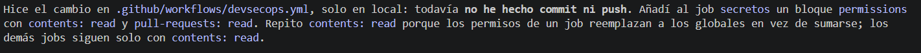
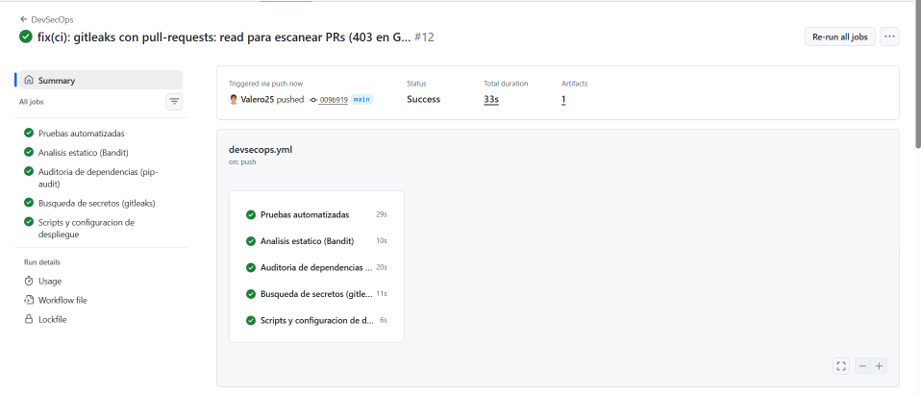
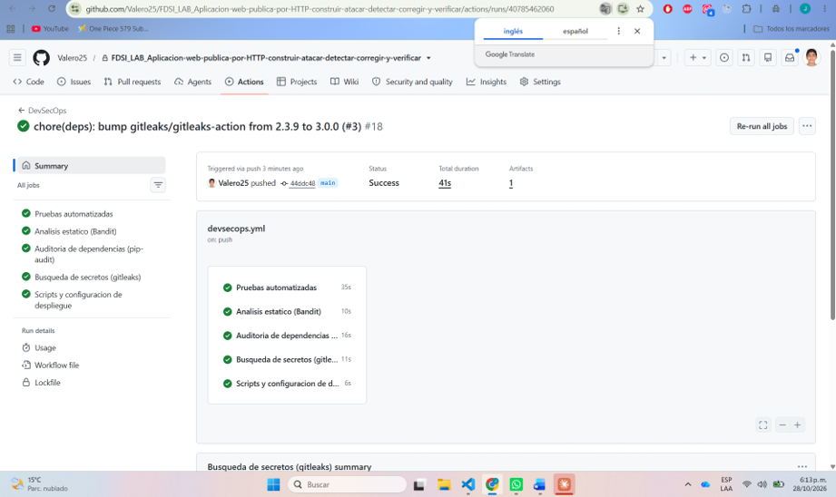
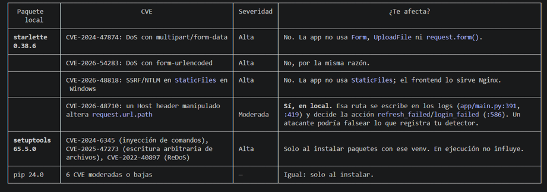

# Reporte de hallazgos — Laboratorio FSI

- **Repositorio:** `Valero25/FDSI_LAB_Aplicacion-web-publica-por-HTTP-construir-atacar-detectar-corregir-y-verificar` (público desde el 2026-11-10; antes privado, ver [SECURITY.md §4](SECURITY.md#4-limitaciones))
- **Línea base:** `main` en `44ddc48`. **Ramas de remediación:** `security/lab-fsi` (PR #5) y `security/lab-fsi-cierre` (PR de cierre: CodeQL, Dependency Review y Dependabot pip)
- **Entorno de prueba:** staging HTTPS local en Docker ([deploy/staging-local](../deploy/staging-local/Dockerfile)): Nginx con la configuración del repo, más la API, con claves y datos ficticios. Todo el análisis dinámico fue pasivo o con peticiones inocuas.
- **Evidencias:** [evidencias/antes](evidencias/antes/) y [evidencias/despues](evidencias/despues/), con las salidas originales de cada herramienta (JSON, HTML y texto).

## 1. Resumen comparativo por herramienta

| Herramienta (tipo) | Antes | Después | Evidencia antes → después |
|---|---|---|---|
| **Semgrep** (SAST) | 7 hallazgos: **3 ERROR**, **1 MEDIUM**, 3 WARNING | **0 hallazgos**. La puerta `--severity ERROR --error` termina con código 0 | [semgrep-antes.json](evidencias/antes/semgrep-antes.json) → [semgrep-despues.json](evidencias/despues/semgrep-despues.json) |
| **CodeQL** *default setup* (SAST, suite `extended`, v2.27.4) | **3 alertas** en Python: 2 *high* (`py/bad-tag-filter`, `py/clear-text-logging-sensitive-data`) y 1 *medium* (`py/log-injection`). 0 en JavaScript y en Actions | 1 corregida (H-7), 1 falsa alarma con prueba de regresión (F-5) y 1 riesgo aceptado (F-6) | [codeql-alertas-antes.json](evidencias/ci/codeql/codeql-alertas-antes.json) · [análisis](evidencias/ci/codeql/codeql-analisis-antes.json) |
| **Bandit** (SAST) | 0 altas, 0 medias (2 `nosec` justificados) | 0 altas, 0 medias | [bandit-antes.txt](evidencias/antes/bandit-antes.txt) → [pytest-bandit-pipaudit-despues.txt](evidencias/despues/pytest-bandit-pipaudit-despues.txt) |
| **gitleaks** (secretos, historial completo de 58 commits) | **13 coincidencias** | **0** (`no leaks found`) | [gitleaks-antes.txt](evidencias/antes/gitleaks-antes.txt) → [gitleaks-despues.txt](evidencias/despues/gitleaks-despues.txt) |
| **pip-audit** `app/requirements.txt` (SCA, producción) | 0 vulnerabilidades | 0 vulnerabilidades | [pip-audit-produccion-antes.txt](evidencias/antes/pip-audit-produccion-antes.txt) |
| **pip-audit** venv local `app/.venv` (SCA) | **35 vulnerabilidades** en starlette 0.38.6, setuptools 65.5.0 y pip 24.0 | **0** | [pip-audit-venv-local-antes.txt](evidencias/antes/pip-audit-venv-local-antes.txt) → [pip-audit-venv-local-despues.txt](evidencias/despues/pip-audit-venv-local-despues.txt) |
| **OWASP ZAP baseline** (DAST pasivo) | 0 FAIL, 8 WARN, de ellas **2 medias** (10055 y 10202) y 60 PASS | 0 FAIL, 7 WARN, **1 media** (10202, falsa alarma) y 61 PASS | [zap-antes.html](evidencias/antes/zap-antes.html) → [zap-despues.html](evidencias/despues/zap-despues.html) |
| **pytest** (regresión) | 263 pruebas | **271 pruebas** (269 en verde y 2 omitidas en Windows), 8 de ellas regresiones nuevas | [pytest-bandit-pipaudit-despues.txt](evidencias/despues/pytest-bandit-pipaudit-despues.txt) |

## 2. Cuadro comparativo de hallazgos altos y medios

| ID | Hallazgo | Fuente / severidad | CIA | Antes (evidencia) | Corrección | Después (evidencia) | Estado |
|---|---|---|---|---|---|---|---|
| **H-1** | gitleaks fallaba en los PR (403 en `GET /pulls/{n}/commits`) | CI (alta para el proceso) | I | PR de Dependabot #1, #3 y #4 en rojo por el job `secretos` | `permissions: pull-requests: read` solo en ese job (`009b919`) | Runs #12 y #18 en verde ([capturas](#h-1-gitleaks-fallaba-en-los-pull-requests)) | ✅ Corregido |
| **H-2** | Venv local con starlette 0.38.6, setuptools 65.5.0 y pip 24.0 | pip-audit: 35 CVE, varias **altas** | C/I/D | [pip-audit-venv-local-antes.txt](evidencias/antes/pip-audit-venv-local-antes.txt) | Venv reinstalado desde `requirements.txt`, más la prueba [test_dependencias.py](../tests/test_dependencias.py) | 0 CVE ([despues](evidencias/despues/pip-audit-venv-local-despues.txt)) | ✅ Corregido |
| **H-3** | Un Host header manipulado reescribe la ruta y la acción del audit log | Validación manual del CVE de Starlette (**media**) | **I** | `login_failed` registrado como `refresh_failed` en `/auth/refresh` ([antes](evidencias/antes/validar-host-header-antes.txt)) | `route_path()` y `scope["path"]` en lugar de `request.url.path` | Siempre `login_failed` en `/auth/login`, incluso con Starlette vulnerable ([despues](evidencias/despues/validar-host-header-despues.txt)) | ✅ Corregido |
| **H-4** | CSP sin `form-action` ni `base-uri` (directivas que no heredan de `default-src`) | ZAP 10055, **media** (confianza alta) | I | `default-src 'none'; frame-ancestors 'none'` ([zap-antes.json](evidencias/antes/zap-antes.json)) | Se agregan `form-action 'none'; base-uri 'none'` en Nginx y en la app | CSP completa ([csp-despues.txt](evidencias/despues/csp-despues.txt)); 10055 pasa a PASS | ✅ Corregido |
| **H-5** | Dependabot sin `cooldown` (cadena de suministro) | Semgrep `dependabot-missing-cooldown`, **MEDIUM** | I | [semgrep-antes.json](evidencias/antes/semgrep-antes.json) | `cooldown: default-days: 7` | 0 hallazgos | ✅ Corregido |
| **H-6** | pytest 8.4.2 con PYSEC-2026-1845 (dependencia de desarrollo) | pip-audit, **media** | I | Detectado al auditar el venv | `pytest==9.0.3` (suite completa en verde) y `pip-audit -r requirements-dev.txt` en CI | 0 CVE | ✅ Corregido |
| **H-7** | La prueba que prohíbe scripts en línea no reconocía cierres como `</script >` | CodeQL `py/bad-tag-filter`, **high** (en código de pruebas) | I | Alerta #1 en [tests/test_frontend.py](../tests/test_frontend.py) | El cierre se busca con `</script\b[^>]*>` | La alerta se cierra al fusionar el PR de cierre | ✅ Corregido |
| F-5 | “Log injection”: la ruta y el id de alerta del cliente llegan al audit log | CodeQL `py/log-injection`, **medium** | — | Alerta #3 en `write_log` ([app/main.py](../app/main.py)) | Falsa alarma: `write_log` serializa con `json.dumps`, que escapa `\n` y `\r`. Se prueba con `test_audit_log_cannot_be_forged_with_newlines_from_the_client` | El payload queda dentro del campo `path` de una sola línea JSON | ⚪ Falsa alarma |
| F-6 | El secreto TOTP se imprime en texto claro | CodeQL `py/clear-text-logging-sensitive-data`, **high** | C | Alerta #2 en [app/identity_cli.py](../app/identity_cli.py) | Riesgo aceptado: es la CLI del administrador en el servidor, que muestra el secreto **una sola vez** en su terminal para enrolar el segundo factor. No va a un log ni a un archivo | Se documenta | 🟡 Aceptado |
| F-1 | SQL formateado en `ALTER TABLE` ([app/main.py](../app/main.py)) | Semgrep, **2 × ERROR** | — | `formatted-sql-query`, `sqlalchemy-execute-raw-query` | Falsa alarma: los identificadores salen de la constante `NEW_COLUMNS`. Se marca con `nosemgrep` justificado | 0 | ⚪ Falsa alarma |
| F-2 | Dockerfile sin `USER` | Semgrep, **ERROR** | — | `missing-user-entrypoint` en el staging local | Falsa alarma aceptada: el arranque necesita root, pero la API corre como `muvapi` y los *workers* de Nginx como `www-data` | 0 | ⚪ Falsa alarma |
| F-3 | Formulario de login sin token anti-CSRF | ZAP 10202 (**media**, confianza baja) y Semgrep (WARNING) | — | `<form id="login-form" method="post">` | Falsa alarma: no hay cookies (`credentials: "omit"`), la autenticación es Bearer y `POST /app/` responde 403 | Sigue en ZAP (justificado), 0 en Semgrep | ⚪ Falsa alarma |
| F-4 | 13 “secretos” en el historial | gitleaks | — | [gitleaks-antes.json](evidencias/antes/gitleaks-antes.json) | Revisados uno a uno: claves de prueba, una variable vacía y un `curl` sin credencial. Se ignoran por huella exacta en [.gitleaksignore](../.gitleaksignore) | `no leaks found` | ⚪ Falsa alarma |

Las alertas **informativas o bajas** de ZAP (10015, 10027, 10031, 10049, 10109 y 10111) se revisaron y no requieren cambios. Por ejemplo, la 10031 marca un parámetro de la URL que coincide con un `<option>` de un HTML estático, que no refleja nada, y la 10049 y la 10015 describen el `no-store` y el `no-cache` que se pusieron a propósito.

---

## 3. Detalle de los hallazgos corregidos

### H-1. gitleaks fallaba en los Pull Requests

**Problema.** [devsecops.yml](../.github/workflows/devsecops.yml) solo declaraba `contents: read`. En un evento `pull_request`, `gitleaks-action` lista los commits del PR y, sin `pull-requests: read`, la API respondía 403. Los PR de Dependabot #1, #3 y #4 fallaban por ese motivo.

**Corrección (`009b919`).** Se agregó un bloque `permissions` propio al job `secretos`. Se repite `contents: read` porque los permisos de un job reemplazan a los globales. Los demás jobs siguen con el mínimo privilegio.



**Después.** El run #12 (`009b919`) y el run #18 (`44ddc48`, con gitleaks-action v3.0.0) quedaron en verde. Las ejecuciones *cancelled* de #1 y #4 en `main` las causa la regla `concurrency: cancel-in-progress`; no son fallos.




### H-2. SCA: dependencia vulnerable en el entorno local (Starlette 0.38.6)

**Dependencia seleccionada:** `starlette`. En el entorno virtual local estaba la versión **0.38.6**, que FastAPI 0.115.0 arrastraba. La versión fijada en `app/requirements.txt` es FastAPI 0.142.2, que instala Starlette 1.10.0.

**Alcance:** solo el entorno de desarrollo de un integrante. El servidor y la CI instalan desde `requirements.txt` y pip-audit los da limpios. Aun así, ese venv era el que se usaba para correr la app y las pruebas en local. Además, ya ni siquiera arrancaba la versión actual: le faltaba `PyJWT`.



**¿Aplica realmente al código?**

- **DoS con multipart y urlencoded:** no aplica. La app no usa `Form`, `UploadFile` ni `request.form()`, y responde 415 a cualquier cuerpo que no sea JSON.
- **`StaticFiles`:** no aplica. Nginx sirve el frontend.
- **El Host header que altera `request.url.path`:** sí aplica, y se validó en H-3.
- **setuptools y pip:** solo afectan al instalar paquetes.

**Medida correctiva:**

1. Se reinstaló el venv desde los archivos fijados, sin actualizar a ciegas: se respetó el rango de Starlette que fija FastAPI.
2. Se actualizaron pip (26.2.2) y setuptools (84.2.1).
3. Se agregó [tests/test_dependencias.py](../tests/test_dependencias.py), que falla si el entorno no coincide con los *pins* o si Starlette es menor que 1.3.

### H-3. Pentest controlado (validación manual): un Host header manipulado falsea el audit log

**Hipótesis.** El audit log y la decisión entre `login_failed` y `refresh_failed` se basan en `request.url.path`. Starlette construye esa ruta con la cabecera `Host`, que controla el cliente. Con Starlette menor que 1.3, un `Host` como `lab/auth/refresh?` debería cambiar la ruta registrada.

**Validación con una petición inocua.** Se envió un login con cuerpo inválido (`{bad`), en un contenedor aislado, sin cuentas reales y sin tocar sistemas de terceros. El procedimiento está en [validar-host-header.sh](../deploy/staging-local/validar-host-header.sh).

| Escenario | Petición real | Registrado en `actions.log` |
|---|---|---|
| **Antes:** código original con Starlette 0.38.6 | `POST /auth/login` con `Host: lab/auth/refresh?` | `"action": "refresh_failed", "path": "/auth/refresh"` ❌ |
| **Después:** código corregido con Starlette 0.38.6 | igual | `"action": "login_failed", "path": "/auth/login"` ✅ |
| **Después:** código corregido con Starlette 1.10 | igual | `"action": "login_failed", "path": "/auth/login"` ✅ |
| A través de Nginx (staging) | igual | Nginx responde **400** y la petición no llega a la app ([host-header-nginx.txt](evidencias/despues/host-header-nginx.txt)) |

**Impacto (integridad).** Un atacante podía registrar sus intentos de login como si fueran de *refresh* y con otra ruta. Así engañaba a `scripts/detect.py` y a las reglas que cuentan fallos de login. En el despliegue real, Nginx lo impide porque fija `Host` y rechaza los valores inválidos. El riesgo existía al ejecutar la API directamente (desarrollo o una mala configuración).

**Corrección.** Se agregó `route_path()` en [app/main.py](../app/main.py), que toma `request.scope["path"]` (la ruta que de verdad se enrutó) en los tres puntos que usaban `request.url.path`. Así la defensa ya no depende de la versión de Starlette ni de Nginx.

**Regresión.** `test_spoofed_host_cannot_rewrite_audited_path_or_action` en [tests/test_identity.py](../tests/test_identity.py) prueba tres valores de `Host`. Se comprobó que **falla con el código anterior** ([regresion-host-codigo-antes.txt](evidencias/antes/regresion-host-codigo-antes.txt)) y pasa con el nuevo, incluso con Starlette 0.38.6.

### H-4. CSP sin `form-action` ni `base-uri` (ZAP 10055)

**Antes.** Las respuestas de la API, tanto de Nginx como de la app, enviaban `Content-Security-Policy: default-src 'none'; frame-ancestors 'none'`. `form-action`, `base-uri` y `frame-ancestors` **no heredan** de `default-src`, así que la política no restringía el envío de formularios ni la etiqueta `<base>`.

**Corrección.** Se usa `default-src 'none'; form-action 'none'; base-uri 'none'; frame-ancestors 'none'` en [nginx/muvautomation.conf](../nginx/muvautomation.conf) y en la constante `API_CSP` de la app (defensa en profundidad). La CSP del frontend (`/app/`) ya declaraba las tres directivas.

**Después.** ZAP pasa de 60 a 61 PASS y la 10055 desaparece. Ver `curl -skI https://127.0.0.1:8443/` en [csp-despues.txt](evidencias/despues/csp-despues.txt).

**Regresión.** `test_every_csp_declares_directives_without_fallback` en [tests/test_nginx_frontend.py](../tests/test_nginx_frontend.py) y la comprobación de la cabecera en `test_api_responses_are_not_cacheable_and_have_security_headers`.

### H-5. Dependabot sin `cooldown`

Semgrep (MEDIUM) detectó que Dependabot proponía cualquier versión el mismo día de su publicación. Si una acción de GitHub se compromete, la versión maliciosa llegaría como PR de inmediato. Con `cooldown: default-days: 7` hay una semana para que la comunidad la detecte y la retire.

### H-6. pytest 8.4.2 (PYSEC-2026-1845)

pytest apareció al auditar el venv recreado. Antes de actualizar se comprobó la compatibilidad: la suite completa pasa con `pytest==9.0.3` (270 pruebas). Además, la CI ahora audita también `requirements-dev.txt`.

## 4. Dos resultados de Semgrep explicados (paso 3)

1. **`dependabot-missing-cooldown` (MEDIUM): verdadero positivo.** La configuración permitía adoptar versiones recién publicadas, que es un riesgo real de cadena de suministro. Se corrigió en H-5.
2. **`formatted-sql-query` y `sqlalchemy-execute-raw-query` (ERROR): falsa alarma.** La regla ve un f-string dentro de `conn.execute`, pero `column` y `sql_type` salen de la constante `NEW_COLUMNS`, definida en el código. Ningún dato del cliente llega a esa línea. Además, SQLite no admite parámetros `?` para identificadores en `ALTER TABLE`. Las consultas con datos del usuario ya usan parámetros. Se dejó `nosemgrep` con la justificación en el código.

## 5. Procedimientos de regresión

```bash
python -m pytest -q
```

```bash
docker run --rm -e OLD=1 -v "$PWD:/src:ro" -w /src python:3.12-slim bash deploy/staging-local/validar-host-header.sh
```

```bash
docker build -f deploy/staging-local/Dockerfile -t fdsi-staging .
```

```bash
docker run --rm -d --name staging -p 127.0.0.1:8443:443 fdsi-staging
```

En GitHub, los workflows `Seguridad estatica` (en cada PR) y `DAST staging` (manual) generan los artefactos `resultado-semgrep` e `informe-zap`.

### Resultado en CI (PR #5)

| Workflow / job | Resultado |
|---|---|
| DevSecOps: pruebas, Bandit, pip-audit (producción y desarrollo), gitleaks, scripts | ✅ los 5 jobs en verde (run `40792199803`) |
| Seguridad estática: Semgrep | ✅ `Ran 546 rules on 63 files: 0 findings`. La puerta ERROR también da 0 |
| Seguridad estática: gitleaks | ✅ `No leaks detected` (6 commits del PR) |

El artefacto descargado está en [evidencias/ci/resultado-semgrep/semgrep.json](evidencias/ci/resultado-semgrep/semgrep.json): 0 resultados y 2 errores de parseo parcial, en `deploy/harden-host.sh` y `deploy/waf-smoke.sh`, que es una limitación del analizador de Bash. El SARIF (2 MB) no se versiona; se descarga desde Actions.

### DAST en GitHub Actions (después de fusionar el PR #5)

Se ejecutó el workflow `DAST staging` a mano sobre `main` (`08e2da9`), run `40792582162`. Como no hay variable `STAGING_URL`, el workflow levantó el staging aislado dentro del runner y ZAP analizó `https://localhost:8443/app/`.

| Resultado | Valor |
|---|---|
| Resumen | `FAIL-NEW: 0  WARN-NEW: 7  PASS: 61` (igual que el escaneo local posterior a las correcciones) |
| Alertas medias | Solo la 10202 (falsa alarma F-3). **La 10055 (H-4) ya no aparece** |
| Informe | [evidencias/ci/informe-zap/informe-zap.html](evidencias/ci/informe-zap/informe-zap.html) (también en [JSON](evidencias/ci/informe-zap/informe-zap.json) y [Markdown](evidencias/ci/informe-zap/informe-zap.md)) |

**Alcance de gitleaks en CI:** en un PR, `gitleaks-action` revisa solo los commits del PR. El historial completo (64 commits, después de los cambios) se revisó con `gitleaks git .` en local: `no leaks found`.

## 6. Limitaciones

- ZAP baseline es pasivo. El staging local no incluye el WAF ni fail2ban de la VM, que están cubiertos por `tests/test_waf_config.py` y `deploy/waf-smoke.sh`.
- Los controles nativos de GitHub (CodeQL y secret scanning) dependen del plan en un repositorio privado. Ver [SECURITY.md](SECURITY.md#4-limitaciones).
- F-3 (10202) sigue apareciendo en ZAP porque la herramienta no puede saber que el formulario se envía con `fetch` sin cookies. Se documenta en lugar de ocultarla.
- CodeQL y secret scanning solo existen desde que el repositorio es público (2026-11-10). Antes, Semgrep y gitleaks cubrían esos papeles.
- El pentest fue deliberadamente acotado: peticiones inocuas, un contenedor aislado y cuentas ficticias. No se probó fuerza bruta ni denegación de servicio, que prohíben las condiciones del laboratorio. El *rate limit* y el bloqueo por cuenta se verifican con pruebas automatizadas.

## 7. CodeQL (PR de cierre)

Al pasar el repositorio a público se activó CodeQL *default setup* con la suite `extended`. El primer análisis (run `42888933539`, sobre `7511b4c`) revisó Python (50 reglas), JavaScript/TypeScript (103) y los workflows de Actions (23), y dio **3 alertas, todas en Python**:

1. **#1 `py/bad-tag-filter` (high) → H-7, verdadero positivo en una prueba.** La prueba que garantiza que el HTML no tiene scripts en línea buscaba el cierre literal `</script>`. El navegador también acepta `</script >`, así que un script cerrado así escapaba de la comprobación. Se corrigió la expresión regular.
2. **#3 `py/log-injection` (medium) → F-5, falsa alarma demostrada.** CodeQL ve que un dato del cliente llega a `action_logger.info()`, pero no modela que `json.dumps` escapa los saltos de línea. La prueba nueva envía `GET /alerts/x%0A%0D{"action":"login_ok",...}` y verifica que no aparece ninguna entrada forjada y que el payload queda dentro del campo `path`.
3. **#2 `py/clear-text-logging-sensitive-data` (high) → F-6, riesgo aceptado.** `identity_cli enroll-totp` imprime el secreto TOTP una vez, en la terminal del administrador. Es el comportamiento esperado de un enrolamiento: el secreto se guarda cifrado con Fernet y nunca pasa por el audit log.

**Lección:** CodeQL sigue el flujo de datos entre funciones y encontró algo que Semgrep (patrones) y Bandit no marcaron. Al revés, Semgrep detectó la configuración de Dependabot (H-5), que CodeQL no revisa. Usar los dos se justifica.

### Nueva ejecución después del PR #6

- **CodeQL:** al fusionar el PR #6 (`424ac63`), el análisis de `main` marcó la alerta #1 como **fixed** (2026-11-10 20:00 UTC). Las #2 y #3 se descartan en GitHub con la justificación de F-6 y F-5.
- **DAST:** run `42891157649` de `DAST staging` sobre `main`: igual que antes, la única alerta media es la 10202 (F-3) y la 10055 no reaparece. Informe en [evidencias/ci/informe-zap-final](evidencias/ci/informe-zap-final/informe-zap.html).

## 7.1 Dependabot pip: primeras propuestas y decisión (SCA)

Al activar Dependabot para pip se abrieron 5 PRs de *version updates*. Ninguno es de seguridad: Dependabot alerts sigue en 0 y pip-audit no reporta CVE en las versiones actuales.

| PR | Cambio | Decisión |
|---|---|---|
| #7, #8 | fastapi y uvicorn **desde la raíz** | **Duplicados (H-8).** `requirements-dev.txt` incluye `-r app/requirements.txt`, así que la entrada `/` de Dependabot volvía a proponer las dependencias de producción. Se corrige con `allow` (solo `pytest` y `httpx` en la raíz) y se cierran |
| #9 | pytest 9.0.3 → 9.2.0 (desarrollo) | Solo afecta a las pruebas y la CI está en verde. Se puede fusionar |
| #10 | uvicorn 0.40.0 → 0.54.0 (`/app`) | No corrige ninguna vulnerabilidad y es un salto de 14 versiones menores del servidor ASGI. La CI está en verde, pero antes de fusionarlo hay que probarlo en el staging local (`--no-server-header` y los *proxy headers* detrás de Nginx). **No se actualiza a ciegas** |
| #11 | fastapi 0.142.2 → 0.162.0 (`/app`) | Igual criterio: arrastra otra versión de Starlette, de la que depende la corrección H-3. Se revisa el changelog, se vuelven a correr `validar-host-header.sh` y ZAP, y recién entonces se fusiona |

## 8. Arquitectura del pipeline

```
push / pull_request a main
├── DevSecOps (devsecops.yml)
│   ├── pruebas ............ pytest (regresiones H-2, H-3, H-4, H-7, F-5)
│   ├── sast ............... Bandit (puerta en severidad alta)
│   ├── dependencias ....... pip-audit --strict (producción y desarrollo)
│   ├── secretos ........... gitleaks
│   └── despliegue ......... bash -n, ShellCheck, finales de línea LF
├── Seguridad estatica (seguridad-estatica.yml)
│   ├── semgrep ............ artefacto resultado-semgrep + puerta en ERROR
│   ├── secretos ........... gitleaks
│   └── revision-dependencias  Dependency Review (solo en PR, falla desde moderada)
└── CodeQL (default setup de GitHub) ... Python, JS/TS y Actions → pestaña Security

Manual (workflow_dispatch)
└── DAST staging (dast-staging.yml) .... staging HTTPS en el runner → ZAP baseline → artefacto informe-zap

Nativos de GitHub: Dependabot alerts + security updates, Dependabot version updates
(Actions y pip, cooldown de 7 días), secret scanning + push protection.
```

Todas las acciones de terceros se fijan por SHA de commit y las imágenes por *digest*; los workflows tienen `permissions: contents: read` y solo el job de gitleaks agrega `pull-requests: read`.

## 9. Conclusiones y aprendizajes

- **Un check verde no significa una aplicación segura.** Los informes de Semgrep y ZAP no bloquean (`|| true`) y la puerta solo corta en severidad alta. La seguridad la demuestra el ciclo completo de cada hallazgo: detectarlo, entenderlo, corregirlo y volver a ejecutar la herramienta (H-1 a H-7).
- **Cada herramienta ve una capa distinta.** SAST encontró configuración y código (H-5, H-7), SCA encontró dependencias (H-2, H-6), DAST encontró cabeceras HTTP (H-4), y el hallazgo con más impacto (H-3, integridad del audit log) salió de unir un CVE de SCA con una validación manual. Ninguna herramienta lo habría encontrado sola.
- **La mitad de los resultados fueron falsas alarmas** (F-1 a F-6). Clasificarlas con una justificación verificable (una prueba, una huella en `.gitleaksignore`, un `nosemgrep` comentado) vale tanto como corregir, y evita apagar el escáner.
- **Que una dependencia sea vulnerable no implica que el código sea explotable.** De los 35 CVE de H-2 solo uno era alcanzable desde el código, y se corrigió en la aplicación (`scope["path"]`), de modo que la defensa no depende de la versión de Starlette.
- **El propio pipeline es superficie de ataque:** permisos mínimos, acciones fijadas por SHA y un `cooldown` en Dependabot reducen el riesgo de cadena de suministro.
- **Riesgo residual:** F-3 (CSRF en ZAP, mitigado por no usar cookies), F-6 (secreto TOTP en la terminal del administrador) y que el staging del DAST no incluye el WAF ni fail2ban de la VM.
